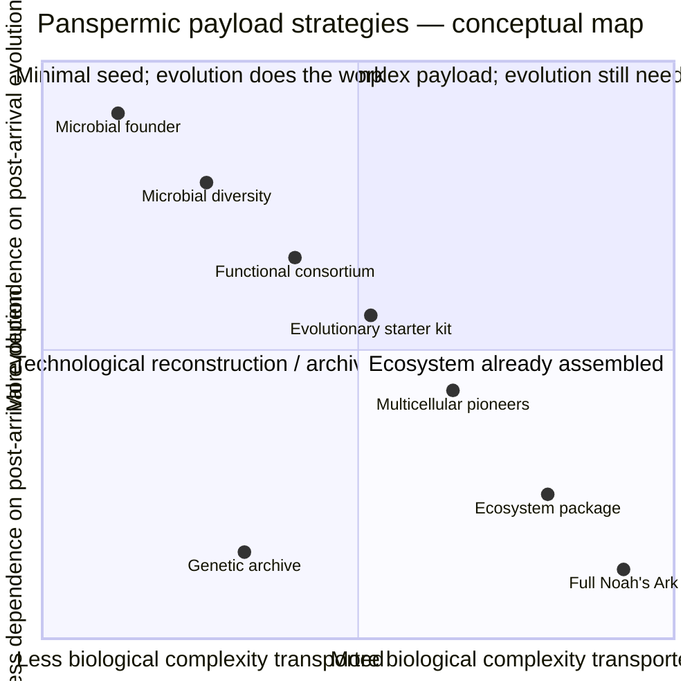

# The Panspermia Spectrum: From a Single Microbe to Noah's Ark

**Rocks2Space — Conceptual Research Framework (draft)**

*How much of a biosphere must travel between worlds, and how much can develop after arrival?*

## 1. The central question

Panspermia is often imagined as transport of microorganisms between planets. A bacterium survives inside a rock, reaches a suitable environment, reproduces, and—given sufficient time and favorable conditions—its descendants may diversify into a biosphere. That is one end of a broader spectrum.

At the other extreme is a **biological Noah's Ark**: a payload containing a substantial collection of organisms, genetic diversity, ecological relationships, and perhaps infrastructure to establish a complex biosphere without waiting for all major innovations to evolve again.

**How much biological complexity should be transported, and how much should be left to evolution and ecological development at the destination?**

These are conceptual alternatives, not demonstrated methods of establishing life on another world.

## 2. The spectrum of panspermic payloads

These are illustrative positions on a continuum, not rigid categories.

| Level | Strategy | What arrives | What must happen afterward |
|---|---|---|---|
| 1 | **Microbial founder** | One viable microorganism or a very small founding population | Reproduction, adaptation, diversification, potentially immense evolutionary timescales |
| 2 | **Microbial diversity package** | Multiple microorganisms, strains, or species | Establish microbial communities and diversify |
| 3 | **Functional microbial consortium** | Complementary metabolisms and symbiotic partners | Stabilize nutrient cycles and a self-sustaining microbial ecology |
| 4 | **Evolutionary starter kit** | Diverse microbes, eukaryotic cells, and selected dormant propagules | Ecological assembly, adaptation, evolution of missing complexity |
| 5 | **Multicellular pioneer package** | Microbes plus selected plants, fungi, algae, and small multicellular organisms or propagules | Establish habitats, food webs, reproduction, and succession |
| 6 | **Ecosystem reconstruction package** | Broad diversity representing interacting ecological functions | Assemble and maintain multiple habitats and ecological relationships |
| 7 | **Full Noah's Ark** | Comprehensive biological library, reproductive material, genetic diversity, symbionts, and dependencies | Deploy and sustain a functioning biosphere, with less need to re-evolve existing complexity |

A full ark is an idealized endpoint; even a comprehensive collection of Earth's organisms would not guarantee a functioning biosphere in an unfamiliar environment.

## 3. The two extremes

### A. The microbial founder: maximum evolutionary freedom

A single viable bacterium—or a small founding population—reaches an environment where it can survive and reproduce.

**Potential advantages:** tiny payload mass; shielding in natural rock; potentially many independent particles or attempts; selected microbes may tolerate dormancy, desiccation, and radiation; descendants could adapt to local conditions.

**Limitations:** survival is not reproduction; one organism may lack essential resources or partners; narrow genetic diversity may constrain establishment; complex life and technological intelligence are not inevitable outcomes; diversification may require geological timescales.

**Survival, establishment, and long-term evolutionary diversification are distinct hurdles.**

### B. The full Noah's Ark: maximum transported complexity

A comprehensive payload could include bacteria, archaea, microbial eukaryotes, fungi, algae, plants, animals, seeds, spores, embryos, gametes, microbiomes, symbionts, genetic diversity, and organisms responsible for production, decomposition, nutrient cycling, and pollination.

**Potential advantages:** preserves existing lineages and evolutionary innovations; could shorten the path to complex ecosystems in suitable environments; offers a form of biodiversity preservation.

**Limitations:** enormous mass and preservation demands; incompatible survival requirements across organisms; difficult ecological dependencies; need for appropriate atmosphere, chemistry, water, energy, habitats, and often deployment infrastructure; major planetary-protection risks.

A full ark is not merely a larger rock payload. It may require **planetary ecological engineering**.

## 4. The middle ground: transporting capabilities

Intermediate payloads could preserve **metabolic diversity** (complementary energy and nutrient pathways), **ecological foundations** (primary producers, decomposers, nutrient cyclers, symbionts), **evolutionary diversity** (multiple lineages), and **dormant multicellular propagules** (seeds, spores, cysts).

A **genetic archive** preserves information rather than living ecological function. DNA alone cannot establish a biosphere without machinery to interpret and reconstruct organisms.

The key measure may not be the number of species carried but the **biological functions and developmental possibilities that survive transport and can be realized after arrival**.

## 5. The fundamental trade-off

| Dimension | Microbial founder | Full biological ark |
|---|---|---|
| Payload mass | Potentially tiny | Potentially enormous |
| Diversity transported | Minimal | Extensive |
| Preservation demands | Relatively low for selected hardy organisms | Extremely high |
| Dependence on future evolution | Very high | Lower, never zero |
| Deployment infrastructure | Potentially low | Potentially very high |
| Time to complex ecosystems | Potentially geological | Potentially shorter, conditional on successful establishment |
| Probability of establishment | Unknown | Also unknown |
| Ecological intervention | Small introduction; potentially large future consequences | Potentially immediate and extensive |

The relationship is **not necessarily monotonic**: adding organisms can provide missing functions but also introduce fragility, competition, and dependencies. More diversity does not automatically mean more successful establishment.

## 6. Draft diagram: two-dimensional payload map

The horizontal axis is **biological complexity transported**. The vertical axis is **dependence on post-arrival evolution**. This is a *qualitative conceptual map*, not an empirical ranking or probability estimate. Coordinates are deliberately omitted.

**Interpretation:** A microbial founder lies toward the upper left: little complexity transported and considerable evolution required. An ark lies toward the lower right: extensive complexity transported and comparatively less *evolutionary invention* needed. A genetic archive sits away from the main diagonal because it may depend on extensive technological reconstruction rather than evolution. Its low vertical position **does not imply easy establishment**.

**Caution:** The diagonal placement is illustrative, not a biological law. A functional microbial consortium may still need extensive evolution, and an ark still requires ecological adaptation. The archive example shows why a second axis alone cannot capture technological dependence.

### A one-dimensional overview

*Left to right: generally more transported biological complexity and ecological functionality; not necessarily greater feasibility or establishment probability.*

## 7. Beyond two axes

A scientific classification should distinguish at least:

- **Biological complexity transported:** How much of the tree of life and its organization is represented?
- **Evolutionary autonomy:** How much innovation must occur after arrival?
- **Ecological completeness:** Can the organisms sustain one another and their environment?
- **Technological dependence:** Is passive establishment possible, or are robots, laboratories, or artificial habitats required?
- **Environmental dependence:** How Earth-like must the destination be?
- **Temporal ambition:** Geological evolution versus shorter-term ecosystem construction.
- **Preservation versus propagation:** Preserve extant biodiversity, initiate new lineages, or build functioning ecosystems.

## 8. Significance for Rocks2Space

Rocks2Space initially investigates small biological payloads protected by rock and delivered toward solar-escape trajectories. But **the smallest payload is not necessarily the most effective**.

A guiding question is:

> What is the smallest, simplest biological package capable of establishing a persistent and evolving biosphere under specified destination conditions?

Research directions include minimum founding populations, functional completeness, evolutionary potential, payload resilience, delivery economics, destination compatibility, and planetary protection.

These questions do not presume that deliberate biological release is feasible or authorized.

## 9. An ark versus a seed

A seed does not contain an entire forest. It contains a living developmental system that can grow, reproduce, and participate in an ecosystem under suitable conditions. An ark attempts to carry much more of the forest itself.

**At one end, we send a biological seed and depend on evolution. At the other, we send a biological ark and preserve much of what evolution has already created.** Between them lie increasingly capable starter packages.

## 10. Scientific and ethical boundaries

This framework does not establish that interstellar lithopanspermia has occurred, that any payload can survive an interstellar journey, or that a suitable destination exists. Introducing terrestrial life could threaten indigenous biology or compromise scientific investigation. An apparently uninhabited world is not necessarily sterile.

Studying payload concepts must remain distinct from authorization to release organisms. Any future proposal would require rigorous planetary-protection assessment, governance, and destination-specific evidence.

## 11. Conclusion

The spectrum runs from **minimal biological founders with maximum dependence on future evolution** to **comprehensive biological arks carrying much of life's existing complexity**. The most promising point may be neither extreme.

**We may not need to send the whole forest. But we must understand what makes a seed capable of becoming one.**
